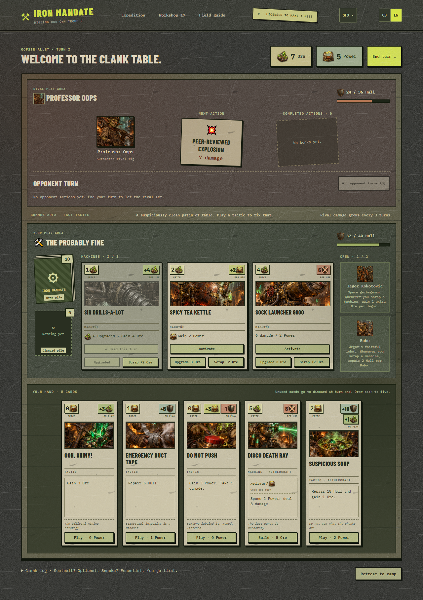

# Iron Mandate

**Iron Mandate** / **Železný mandát** is a gritty fantasy / steampunk card battler built with plain HTML, CSS, and JavaScript. Mine Ore, generate Power, assemble questionable machinery, and defeat rival crews to build a better deck.



## Play

Open `index.html` in a modern browser. No installation or build step is needed. Google Fonts are optional; system fonts work offline.

- Four rival encounters and seventeen illustrated cards.
- Machine upgrades, crew abilities, and a customizable 15-card deck.
- Jegor Kokotovič, the space garbageman, and his faithful robot Bobo.
- Portrait phone controls with swipeable cards and larger detail panels.
- English and Czech, with a remembered language preference.
- Original sound effects with saved mute and volume controls.
- Opponent actions shown one at a time, with effects and turn history.

Your collection, deck, and preferences are saved in your browser. Battles restart when the page reloads. Opponents use escalating attack patterns in this prototype.

## Project layout

```text
index.html             Game entry point
js/                    Game logic, card data, localization, and sound
css/                   Layout, card styling, and visual theme
assets/images/         Card paintings, scene artwork, and textures
assets/icons/          Transparent resource icons
assets/audio/          Original WAV sound effects
assets/screenshots/    README screenshots
tools/                 Sound-generation utility
```

Core cards and opponents are defined in `js/game.js`; Jegor and Bobo are in `js/salvage-crew.js`. Card presentation is in `js/card-layout.js` and `css/card-layout.css`.

Regenerate the sound effects with `python tools/generate_sounds.py` (Python standard library only). This replaces the generated WAV files in `assets/audio/`.

## License

[MIT](LICENSE). Artwork was generated for this project; sound effects were synthesized locally. Optional Google Fonts are served externally under their respective licenses.

Card rarity tiers are Common, Uncommon, Rare, Unique, and Legendary, defined in `js/rarity.js`. Rarity is shown with a label, rank, and frame accent. It does not change costs or the current two-copy deck limit.

The active art set is in `assets/images/handdrawn/`: ink contours, cross-hatching, and watercolor washes on textured paper. Earlier painted versions remain in `assets/images/` as backups. Resource icons are in `assets/icons/`.
